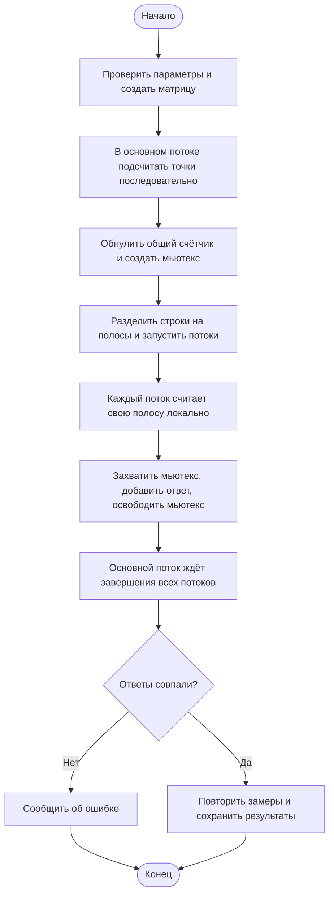

# Пункт 1.5, вариант 3: параллельная обработка матрицы

Источник: `090401_МУ_ЛР_ССП.pdf`, страницы 13–14. Файл найден в Documents.
Номер варианта в новом сообщении пропущен; выбран вариант 3, как в предыдущей работе.

## Задание

Дана вещественная прямоугольная матрица. В чётных столбцах находятся X,
в нечётных — Y. Нужно подсчитать точки дальше заданного расстояния R от начала
координат. Разделить матрицу на подматрицы, обработать их в отдельных потоках,
защитить общий результат мьютексом. Проверить ответ последовательным подсчётом,
сравнить времена и построить графики для разных размеров.

Нумерация столбцов начинается с нуля: строка `3 4 6 0` содержит точки
`(3,4)` и `(6,0)`. Столбцов должно быть чётное число, чтобы каждая X имела Y.
Точка на расстоянии ровно R не считается: проверяется строгое неравенство.

## Установка на Arch Linux

Для сборки и запуска основной программы:

```bash
sudo pacman -Syu --needed base-devel
```

Для автоматических проверок и графиков:

```bash
sudo pacman -Syu --needed python python-matplotlib
```

`base-devel` содержит GCC (команда `g++`) и Make. Потоки POSIX (`pthread`)
доступны через системную библиотеку Linux; отдельный пакет для них не требуется.
Matplotlib нужен только скрипту графиков.
Пакеты: [base-devel](https://archlinux.org/packages/core/any/base-devel/),
[python-matplotlib](https://archlinux.org/packages/extra/x86_64/python-matplotlib/).

## Сборка и запуск

```bash
cd /home/st3pegor/Projects/tusur/ssp/lab1/lab15_variant3
make
./points
```

Без аргументов: матрица 1000 × 1000, 4 потока, R = 50.
Числа генерируются воспроизводимо в диапазоне от -100 до 100.
Собрать напрямую без Make можно так:

```bash
g++ -std=c++11 -O2 -Wall -Wextra -Wpedantic -pthread main.cpp -o points
```

Свой размер, количество потоков и расстояние:

```bash
./points 2000 1000 4 50
```

Порядок аргументов: **строки, столбцы, потоки, расстояние, [повторы]**.
Последний аргумент необязателен: по умолчанию 7 повторов. Например,
`./points 1000 1000 8 25 11` — 8 потоков, R = 25, 11 повторов.
Строки и столбцы положительные; потоков не больше числа строк и не больше 1024.
Расстояние неотрицательное. Дробные числа вводятся с точкой, например `5.5`.

Ручной ввод небольшой матрицы:

```bash
./points --manual 2 4 2 5
```

После приглашения введите:

```text
3 4 6 0
0 0 -4 -4
```

Ответ **2**: `(6,0)` и `(-4,-4)` находятся дальше 5. `(3,4)` лежит на
границе; `(0,0)` внутри. Каждый поток обрабатывает одну строку.
Результаты обоих способов программа сравнивает при каждом повторе.

## Проверки и графики

Весь пункт методички о зависимости времени от сложности выполняется командой:

```bash
make analysis THREADS=4 REPEATS=7 DISTANCE=50
```

Она измеряет матрицы 20×20, 100×100, 200×1000, 1000×1000, 2000×1000,
2000×2000 и 4000×4000; сохраняет таблицу, строит графики и записывает
вывод в `results/timings.txt`. На графике вертикальная пунктирная линия
показывает первый исследованный размер, при котором параллельное время меньше
последовательного. Если выигрыша нет, это явно указано в выводе.
Горизонтальная линия ускорения 1 означает равное время двух способов.
Обычный `./points 1000 1000 4 50` измеряет только один размер: для выполнения
этого пункта нужна именно серия. Под «сложностью задачи» здесь понимается
число элементов N, а не изменение класса алгоритмической сложности O(N).

```bash
make check
make benchmark THREADS=4 REPEATS=7 DISTANCE=50
make plot
```

`make benchmark` измеряет семь разных размеров при четырёх потоках.
Можно задать другое количество потоков и повторов:

```bash
mkdir -p results
./points --benchmark 8 11 25
python3 plot.py
```

Порядок параметров серии: потоки, повторы, расстояние (по умолчанию 4, 7, 50).
Для серии замеров потоков должно быть от 1 до 20, повторов от 1 до 101.
Это ограничение позволяет использовать самый маленький размер — 20 строк.

Получаются файлы:

- `results/timings.csv` — последний запуск (одна строка) или последняя серия;
- `results/runs.csv` — история: новые измерения добавляются в конец;
- `results/timing.png` — графики времени и ускорения;
- `results/timing.svg` — те же графики в векторном формате.
- `results/timings.txt` — настройки и вывод о первом измеренном выигрыше.

Каждая строка CSV содержит время запуска с часовым поясом, строки, столбцы,
число элементов и точек, потоки, повторы, расстояние, способ ввода, seed
генератора, оба результата, оба времени и ускорение. CSV хранит параметры и
итоговые показатели; сами координаты матрицы в него не записываются.

Все команды выполняйте из каталога этого проекта. Любой успешный запуск
заменяет `timings.csv` и дополняет `runs.csv`. После него запустите `make plot`,
чтобы обновить изображения. Для одного размера строятся столбики сравнения,
для серии размеров — графики зависимости. Настройки на картинке берутся из CSV,
включая расстояние и число потоков. Чтобы сохранить отдельный опыт, скопируйте
его CSV и постройте график рядом с ним:

```bash
./points 1000 1000 8 25
cp results/timings.csv results/experiment_8_threads.csv
python3 plot.py results/experiment_8_threads.csv
```

Новый график появится в `results/experiment_8_threads.png` и `.svg`.
`make benchmark` использует свои параметры, по умолчанию 4/7/50; он не берёт
настройки из предыдущего обычного запуска. Передайте нужные значения явно:
`make benchmark THREADS=8 REPEATS=11 DISTANCE=25`.

## Как работает код

Код написан на C++ в стиле C: обычные функции, `struct`, `printf`, `malloc`,
индексы массивов. Основной файл — `main.cpp`, комментарии в нём на русском.

1. `create_matrix()` выделяет массив `double` и заполняет его. Элемент
   матрицы `[i][j]` расположен в массиве по индексу `i * cols + j`.
2. `count_rows()` перебирает заданную полосу строк. Внутри строки шаг равен 2:
   соседние элементы образуют одну точку. Проверяем `x*x + y*y > R*R`.
   Координаты и R ограничены величиной `1e100`, чтобы квадрат не переполнил `double`.
3. `Shared` хранит адрес общей матрицы, параметры, общий счётчик `count` и
   `pthread_mutex_t`. Матрица не изменяется в рабочих потоках.
4. `Task` хранит границы полосы и указатель на один общий `Shared`.
   Границы для потока k: `rows*k/threads` и `rows*(k+1)/threads`.
   Эти полосы не пересекаются и покрывают все строки даже при остатке деления.
5. `pthread_create()` запускает функцию `worker()` для каждой полосы.
   Поток считает локальный результат, затем блокирует мьютекс, прибавляет
   свой результат к общему `count` и освобождает мьютекс.
6. `pthread_join()` ждёт завершения потока. Только после завершения всех
   потоков основной поток читает общий результат и освобождает ресурсы.
7. `measure()` сравнивает ответы и измеряет время обоих способов.

Мьютекс нужен, потому что `count += local` состоит из чтения, сложения и
записи. Без блокировки два потока могут прочитать одно старое значение и
перезаписать результаты друг друга. Блокировка выполняется один раз на поток,
после обработки его полосы, поэтому вычисления самих точек идут параллельно.

Оба способа имеют линейную сложность O(N), где N — число элементов матрицы.
Потоки сокращают время обработки частей, но имеют расходы на создание,
ожидание и синхронизацию. Поэтому маленькие матрицы обычно выгоднее считать
последовательно. Ускорение = последовательное время / параллельное время.
Значение больше 1 означает, что параллельный способ оказался быстрее.

## Как измеряется время

Используется `clock_gettime(CLOCK_MONOTONIC)`. Заполнение матрицы, вывод,
запись CSV и построение графиков в измерение не входят. Параллельное время
включает создание и ожидание потоков, выделение их служебных массивов и мьютекс.
Потоки создаются заново для каждого запуска.

Сначала выполняется прогрев обоих способов. Затем идут 7 повторов с
чередованием порядка способов. В таблицу записывается медиана.
Маленькие значения времени особенно чувствительны к шуму.
Точка первого выигрыша относится только к проверенным размерам и текущей
машине, это не универсальная граница.

В сохранённой серии с 4 потоками первый выигрыш получен на 200 × 1000:
200 000 элементов (100 000 точек), около 0.0760 мс последовательно против
0.0549 мс параллельно. Для 1000 × 1000 получилось около 0.4354 против 0.1525 мс.
После повторного запуска числа могут измениться из-за нагрузки и состояния CPU.

## Диаграмма деятельности


