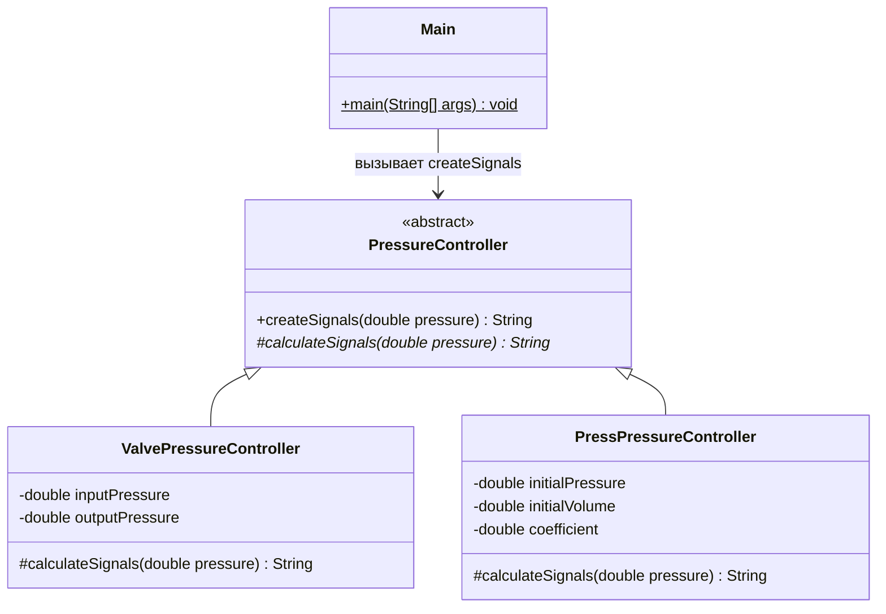

# Лабораторная работа 1.6. Абстрактные классы, вариант 3

Задатчик давления на Java. Четыре класса, без библиотек, Maven и Gradle.
Нужен **JDK 17 или новее** (с командами `java` и `javac`).

## Запуск в IntelliJ IDEA

1. Открой через **File → Open** именно папку `lab16_variant3`.
2. В **File → Project Structure → Project → SDK** выбери установленный JDK 17
   или новее. Если IDEA не нашла JDK, укажи путь к нему через **Add SDK**.
3. Открой `src/Main.java` и нажми зелёный треугольник возле `main` → **Run**.

Настройки модуля и папки исходников уже включены в проект.
Чтобы задать свои давления, открой **Run → Edit Configurations** и укажи
в **Program arguments**, например: `0 2.5 10`.

## Запуск без IDEA

В терминале перейди в папку `lab16_variant3`.

Linux / macOS:

```sh
sh run.sh
sh run.sh 0 2.5 10
```

Windows (командная строка):

```bat
run.bat
run.bat 0 2.5 10
```

В PowerShell: `./run.bat`.

Можно собрать и запустить вручную на любой из этих систем:

```text
mkdir out
javac -encoding UTF-8 -d out src/*.java
java -Dfile.encoding=UTF-8 -cp out Main
java -Dfile.encoding=UTF-8 -cp out Main 0 2.5 10
```

Команда `mkdir out` нужна, только если папки ещё нет.
Аргументы — давления в атмосферах; дробная часть записывается через точку.
Для двух устройств из `Main` общий допустимый диапазон — от 0 до 10 включительно.
При ошибке программа выводит причину и завершается с кодом 1.
Без аргументов демонстрируются давления 1, 3 и 5 атм.

## Цель и задание

Научиться создавать иерархию с абстрактным классом и работать с разными
реализациями через общий тип.

По разделу 1.6, таблице 1.3, варианту 3 методических указаний требуется
создать абстрактный задатчик давления и два производных класса: клапанный
и прессовый. На вход подаётся требуемое давление P, на выходе формируются
управляющие сигналы. Здесь сигналы имитируются текстом в консоли.

## Классы



- `PressureController` проверяет общие ограничения и вызывает абстрактный метод.
- `ValvePressureController` рассчитывает напряжения на двух клапанах.
- `PressPressureController` рассчитывает сигнал пресса и его длительность.
- `Main` задаёт параметры, читает аргументы и выводит результаты.

Исходный код находится в `src/`, по одному классу на файл.
Полиморфизм показан в цикле по массиву `PressureController[]`: один вызов
`controller.createSignals(pressure)` выполняет алгоритм конкретного объекта.

## Формулы и принятые допущения

Все давления — **избыточные**, в атмосферах. В формуле пресса `1 atm = 1`.
Объём измеряется в литрах, время — в секундах. Физические ограничения
оборудования, не заданные в методичке, не моделируются.

### Клапанный задатчик

Формула из задания:

```text
P = (U1 * Pin + U2 * Pout) / (U1 + U2)
```

Одному давлению соответствует много пар напряжений. Для однозначного
решения принимаем `U1 + U2 = 10 В`:

```text
U1 = 10 * (P - Pout) / (Pin - Pout)
U2 = 10 - U1
```

При `Pin > Pout >= 0` и `Pout <= P <= Pin` оба напряжения лежат в `[0, 10]`.
В демонстрации `Pin = 10 атм`, `Pout = 0 атм`.
При P = 3 получаем U1 = 3 В, U2 = 7 В и `(3*10 + 7*0)/10 = 3 атм`.

### Прессовый задатчик

Формулы из задания:

```text
P = (P0 + 1) * V0 / V - 1
V = V0 - k * sum(fi * dti)
```

Достаточно одного управляющего импульса:

```text
V = (P0 + 1) * V0 / (P + 1)
f = sign(V0 - V)
dt = abs(V0 - V) / k
```

`f = +1` сжимает воздух, `f = -1` расширяет, `f = 0` означает отсутствие
движения (dt = 0). Амплитуда сигнала безразмерная; k измеряется в л/с
при единичном сигнале. Это выбранная для имитации нормировка.

В демонстрации `P0 = 1 атм`, `V0 = 10 л`, `k = 0.5 л/с`.
При P = 3 получаем V = 5 л, f = 1, dt = 10 с.
Обратная проверка: `10 - 0.5*1*10 = 5 л`, `(1+1)*10/5 - 1 = 3 атм`.
Каждый вызов рассчитывается **от начального состояния P0, V0**, независимо
от предыдущих вызовов. Так несколько примеров можно сравнивать напрямую.

## SOLID без лишних усложнений

- **S:** каждый драйвер отвечает за сигналы своего устройства, `Main` — за ввод и вывод.
- **O:** новый тип задатчика добавляется наследованием и реализацией
  `calculateSignals`; существующие драйверы менять не требуется.
- **L:** оба наследника соблюдают общий контракт `createSignals`: возвращают
  сигналы либо отклоняют недопустимое или недостижимое давление через
  `IllegalArgumentException`. Доступный диапазон зависит от устройства.
- **I:** общий API содержит один необходимый клиенту метод.
- **D:** цикл демонстрации работает с абстракцией `PressureController`.
  Конкретные объекты создаются в `Main`, где собирается программа.

Отдельные фабрики, контейнеры зависимостей и дополнительные интерфейсы
для этой задачи не нужны.

## Результат запуска

```text
Требуемое давление: 1.000000 атм
Клапанный: U1 = 1.000000 В, U2 = 9.000000 В
Прессовый: f = 0, dt = 0.000000 с, V = 10.000000 л

Требуемое давление: 3.000000 атм
Клапанный: U1 = 3.000000 В, U2 = 7.000000 В
Прессовый: f = 1, dt = 10.000000 с, V = 5.000000 л

Требуемое давление: 5.000000 атм
Клапанный: U1 = 5.000000 В, U2 = 5.000000 В
Прессовый: f = 1, dt = 13.333333 с, V = 3.333333 л
```

При выводе числа округляются до шести знаков после точки.

## Вывод

Создан абстрактный задатчик давления и две его реализации. Общий метод
позволяет получать разные управляющие сигналы через один базовый тип,
не проверяя класс объекта в клиентском коде.
